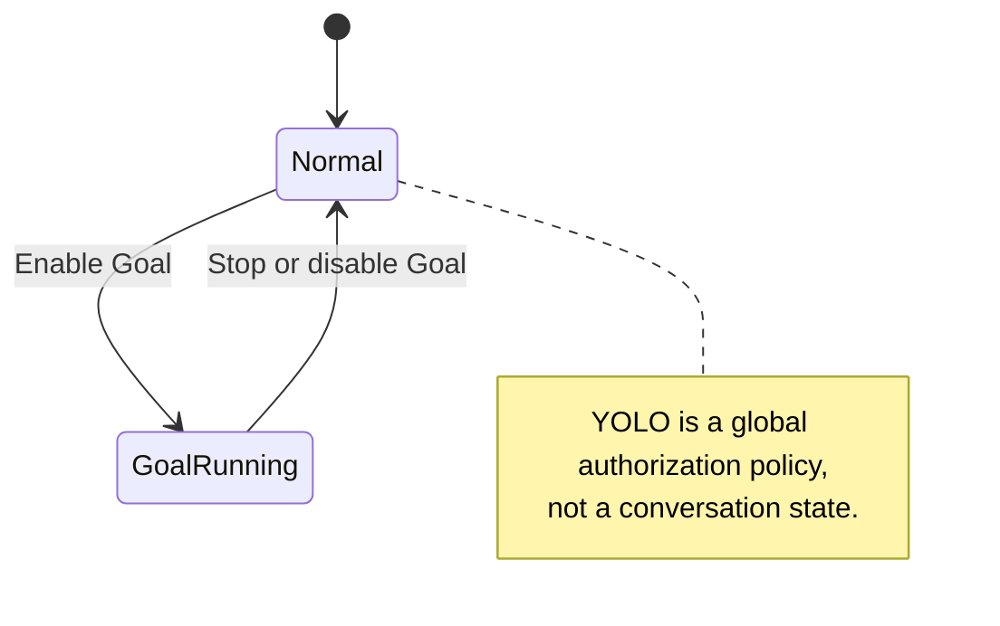
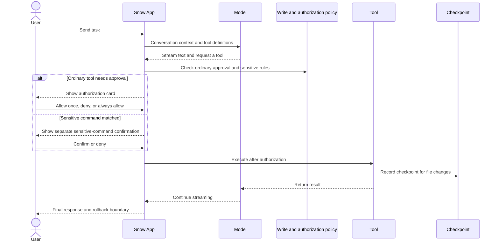

# 10-Using Chat and the AI Assistant

Snow App uses conversation as the main entry point for AI collaboration. In addition to streaming text, the AI can read and modify files, run commands, search the web, operate a browser, generate images, and call sub-agents within the active authorization boundaries. Every step appears as a tool card.

## 1. Interface and First Conversation

### HTML live preview

After a filesystem tool successfully creates, edits or copies an `.html` / `.htm` file, the conversation shows a live preview card outside the tool group; no extra code fence is needed. A final reply containing only a file link reuses one card per file within that run, placed below the referencing reply. Reopening history reconstructs cards from successful persisted tool records. Content is read from the actual local or SSH file, never from tool arguments or edit fragments.

HTML links without successful write evidence offer **Load preview**; only clicking the link or that button reads them. Plain path mentions never trigger reads. Refresh reads the current file; deleted, unreadable, binary or over-2-MiB files do not execute. A subsequent write pauses preview until it succeeds. Cards support code mode, refresh and an explicit app-browser action for local files; automatic preview never opens the right-side browser.

Fenced blocks labelled `html`, `htm`, or `text/html` in AI reply bodies and sections default to live preview; labels are case-insensitive and may include trailing metadata. Automatic execution starts only when the message is not streaming, errored, retrying, or interrupted, the source fence is genuinely closed, and the committed DOM render matches the current content snapshot. Self-contained HTML, CSS, and JavaScript then run in an isolated sandbox. Selecting **Code** removes the iframe and stops execution; later synchronization of the same DOM block does not take preview back from that manual choice. Selecting **Live preview** again starts fresh. Reasoning content, Markdown file readers, and editors still require an explicit preview click. Streaming or unclosed blocks cannot execute. Ordinary Markdown HTML, JavaScript, and React blocks never run automatically.

Code views for HTML fences and file cards provide IDE-style multicolor syntax highlighting for HTML tags and embedded CSS and JavaScript; file cards compute highlighting only when switched to code mode. Language resolution and colors are shared with ordinary chat code blocks, tool source views, and the file reader, adapting to light and dark themes without rerunning previews. Copying and sandbox execution always use the original source. Inputs exceeding the 131,072-character synchronous highlighting budget display the complete, safely escaped plain text without truncation.

Layout is defined only in the shared `src/renderer/styles.css`. At the final stage, Vite embeds the `.html-artifact-frame` and `.html-artifact-carrier` layout rules into the standalone carrier page, without relying on an opaque `file:` sandbox to read external CSS. This prevents the inner iframe from falling back to the top-left `300×150` default size without relaxing sandbox isolation or CSP.

Preview denies network requests, external scripts/styles/fonts, forms, objects, nested frames, and host APIs; inline scripts/styles and data/blob images are allowed. CDN dependencies and JSX compilation are unavailable. The fixed viewport scrolls internally. It provides no CPU/memory quotas and does not promise to prevent self-navigation. Preview only code you trust.

| Area              | Contents                                                                                                                |
| ----------------- | ----------------------------------------------------------------------------------------------------------------------- |
| Sidebar           | Local/SSH projects, conversations, memos, scheduled tasks, and settings                                                 |
| Main area         | AI chat, terminal, Git, browser, codebase, image library, and other views                                               |
| Right panel       | File reader, Markdown/Office/image previews, diffs, and Git panels in multiple tabs                                     |
| Top bar and input | Switch views/API profiles, choose a model and reasoning effort, enter `/` commands, mention `@` files, or attach images |

1. Select a project, then create or open a conversation;
2. Enter a task and send it; use `Shift+Enter` for a newline;
3. The AI streams its response and requests tool authorization when required;
4. Tool results return to the AI, which continues the response.

```text
Find the Python files in this project, inspect the key entry points, and summarize each file's purpose.
```

See [Configure API Keys and Models](3-configure-api-keys.md) for profile and model setup.

**Conversation model routing**: an ordinary conversation uses the model selected for that conversation. Snow App does not automatically switch between basic and advanced models based on prompt complexity. `advancedModel` is only the conversation profile's default advanced model, and `advancedModel` and `basicModel` never fall back to each other.

**Title routing**: the first generated conversation title uses `basicModel`; its provider, credentials, and profile follow the profile bound to that conversation. If the bound profile has been deleted, ordinary-conversation rules fall back to the current active profile.

### 1.1 Manage Local Projects and Workspaces

The **Projects** area in the left sidebar can either create a new directory on disk or register an existing one. These operations have different boundaries:

1. **Create a project**: select **Create project** from the plus menu, enter a name, and choose its parent directory. The main process creates the real project directory, registers it as a local workspace, and makes it active;
2. **Add an existing local directory**: select **Add local directory**, then use the directory picker or drop **exactly one folder** onto the dialog. Snow registers the existing path without copying its contents and makes the new entry active;
3. **Activate and reorder**: click a workspace, or choose **Set as active** from its ellipsis/context menu. Drag workspace rows to reorder them; the resulting `sortOrder` values are persisted;
4. **Rename and remove**: **Rename** changes only the display name inside Snow while preserving the `directoryId` and disk path. Confirming **Delete** removes the registration from the workspace list; it is distinct from deleting files or directories in the project explorer;
5. **Open details**: **Details** opens that workspace in the project explorer, even when it is not currently active. See [Git Panel and Code Browsing](12-git-and-code-browsing.md) for explorer operations.

SSH workspaces do not use the local picker/drop flow. Select **Add SSH directory** to open the separate connection wizard; see [Terminal and SSH](11-terminal-and-ssh.md) for credentials, remote paths, and reconnection behavior.

## 2. Conversations and Input

### 2.1 Conversation Actions

Use the conversation row's ellipsis button or right-click menu to pin/unpin, rename (also available by double-clicking the title), set an icon, export as Markdown/HTML/JSON/CSV, enter multi-select mode, or delete. Draft text and image chips are stored per conversation, restored when you switch back, and cleared after a successful send.

When you switch projects, the chat area automatically opens that project's **running** conversation (streaming or waiting for attention; the first one in the running list when several exist), and starts a new conversation when none is running. A conversation opened explicitly (through a cross-project notification, system notification, or remote control) is never overridden.

Single and batch deletion both require confirmation. Deleting a conversation also stops related streams, cascades to its sub-agent conversations, and clears its input draft. If a conversation references image-library items, the dialog shows a **Delete images too** option:

- It is **off by default**, so deleting a conversation keeps its library images;
- Physical image files and SQLite index rows are removed only when you explicitly select the option;
- Deleting an individual item in the image library is a separate action that removes its file and index entry and rewrites conversation messages that reference it.

#### Dragging a history conversation onto the composer as prefix context

**Drag a history conversation from the sidebar onto the chat composer** to attach it as **prefix context**, injected together with your **next message**:

- An **attachment bar** appears above the composer showing the attached conversations with an estimated character count; each attachment can be removed individually or folded into a summary row;
- Multiple attached conversations are concatenated in drag order before your current message;
- Injection budgets are configurable in settings: single-conversation budget defaults to `40000` characters, total budget to `60000` characters (range `1000–200000`); overflow is truncated;
- Dragging onto a composer that already has a draft works the same way; after a successful send the attachments are consumed and do not linger into later messages.

### 2.2 Cross-Project Notification Aggregation

The sidebar **Conversations** section normally shows only the **current project's** conversations. When conversations in **other projects** become active, they are aggregated into a **cross-project notification** block below the list, so background session state is not lost after switching projects:

- **Aggregated content**: conversations in other projects that are **streaming**, **need attention** (e.g. awaiting approval or a question), or **completed**, grouped by their project, newest update first within each group;
- **Status badges**: streaming conversations show an in-progress animation; conversations needing attention get an **attention-required** emphasis badge (the same indicator appears on entries in the conversation list);
- **Quick jump**: clicking a notification switches to that project and opens the conversation; it then appears in the current project's list as usual;
- **Name fallback**: when a project display name cannot be resolved, the last segment of its directory path is used.

### 2.3 Files and Images

- Type `@` to search workspace files. Browse into folders, use breadcrumbs to jump to a parent, or press the left arrow to go up one level;
- Type `@@<query>` to **search file contents**: only files whose body matches the keyword are listed, each annotated with the matching line numbers and text; selecting one inserts a line-numbered file reference (`file.ts:L5,L20`) and the matching lines are sent to the AI with the message;
- Type `@?<query>` for a **natural-language file search** (see [Git and Code Browsing](12-git-and-code-browsing.md));
- Type `#` to list and search **enabled Skills**, or use `@!<query>`. Select one or more with the arrow keys and Enter or by clicking. When a sent, queued, or steering message is processed, the host loads each selected Skill before the model handles the task. Tool enablement, authorization, and Hooks still apply; rejection or loading failure stops the current task;
- Select or drag a whole directory when the AI should inspect its contents;
- Paste or drag one or more images into the input. If the main model has no vision support, the auxiliary vision model produces a text description while retaining a safe `upload/...` reference to the original for later image editing;
- See [Image Generation](9-image-generation.md) for generation and reference-image rules.

### 2.4 Send Behavior While Busy

Open **General settings → Send behavior while busy** and choose **Steer** or **Queue**. The default is **Steer** when no valid preference is saved; an explicitly saved Queue preference is preserved. The preference is persisted and synchronized to mounted composers after a successful save. A failed save shows an error and keeps the previous behavior.

- **Queue** keeps the message in the current conversation's pending queue until its complete Agent run finishes normally. In the main conversation, this includes tool execution and stop-hook cleanup. Follow-up tasks run one at a time in FIFO order; they are not injected between tools or merged into one prompt.
- **Steer** binds the message to the active run and adds requirements at a safe boundary after a model response or a complete tool batch settles. It continues the current task without canceling running tools or starting a parallel Agent loop. Pending input is labeled **Wait for steer processing**; once submitted in a model request it appears as a user message, which does not prove that the instruction has been executed successfully.
- **Interrupt and send** remains a separate arrow action on a pending-message card. It stops the current run and resubmits the selected input; it is not steering.

A run finishing means that the current Agent execution ends, not that the conversation window is closed or that a business goal is guaranteed to have succeeded. For example, queue “After this, organize the settings page” as a separate next task; steer “Keep the current public interface unchanged” to amend the task in progress. Neither steering nor interrupting automatically rolls back completed actions.

While busy, the send button and the preferred send key use the saved behavior. The menu beside the button can send one message as Queue or Steer without changing that preference:

| Preferred send key | Saved behavior | Alternate behavior for this send |
| ------------------ | -------------- | -------------------------------- |
| Enter              | Enter          | Ctrl/Cmd+Enter                   |
| Ctrl/Cmd+Enter     | Ctrl/Cmd+Enter | Ctrl/Cmd+Shift+Enter             |

`Shift+Enter` still inserts a newline, and IME composition does not trigger sending. Idle conversations send normally. Programmatic messages from plugins or scheduled tasks do not inherit the manual Steer preference.

Queues stay scoped to their owning conversation. A user stop, terminal failure, or non-continuable authorization rejection retains pending messages without automatically starting the next task; unconsumed steers become queued follow-ups. A steer requesting incompatible runtime settings, such as another model or API profile, also becomes a follow-up. Sub-agents and Workflow nodes retain unsupported configuration changes with an explanatory message rather than forwarding them to the parent.

**Pending queues are in-memory state for the current app run, with no promise of restoration after closing or restarting the app.** Only the send-behavior preference is persisted. A queued or pending steer can be withdrawn to the composer before consumption; an already-consumed instruction must be corrected by another message.

### 2.5 Manually Optimize a Draft (Unreleased Source Capability)

These behaviors require the accompanying host build and a trusted ESM plugin contributing the action. No released version is confirmed; installing a plugin does not upgrade Snow App.

- Click the plugin wand before the model selector to manually optimize the draft's plain text. Optimization remains available while the Agent runs or stops if the input is editable; compaction, empty plain text or unavailable API configuration prevents execution.
- Optimization refills only the draft, never sends automatically or edits queued entries. You still choose when to send using the Queue / Steer rules in section 2.4. Optimization cancellation is independent of ordinary chat and does not stop the Agent.
- Apply and Undo use single-use tokens bound to the input instance, project, real / pending conversation, draft revision and original content. Edits, actual sends that clear the draft, context switches or compaction reject stale results; live replies and running / stopping alone do not invalidate tokens.
- After a successful optimization, Undo lives in the "More actions" dropdown next to the wand instead of the input toolbar; the toolbar no longer shows a persistent diff or preview box.
- Prompt Optimizer hides its configuration gear by default but retains the wand. Its right-panel visibility switch persists independently; hiding the gear neither disables the plugin nor saves unsaved strategy edits. Other plugins choose their defaults through generic `chatInputSettings`; omission keeps the gear visible. Opening the gear only opens settings, without running or canceling optimization.

The pending-message area is capped at `min(144px, 20vh)` and scrolls internally when needed. This does not change Queue / Steer semantics or the queue's in-memory lifetime.

See [Plugin development and installation, section 6.1](24-plugin-development-and-installation.md) for the contract. Source anchors: `src/renderer/components/mainContent/chatInput/ChatInputPluginAction.tsx`, `src/renderer/plugins/pluginDraft.ts`, and `src/renderer/styles.css`.

### 2.6 Manual WorkFlow Composition

With WorkFlow mode enabled, a composer entry appears in the mode-indicator area right of the divider in the input toolbar (WorkFlow icon, tooltip **Compose a WorkFlow**; it replaces the former static WorkFlow mode badge with one clickable entry), and clicking it opens the **WorkFlow composer** dialog, where you draw a workflow graph yourself. The entry is only shown while WorkFlow mode is on and disappears from the toolbar once the mode is turned off; the button is disabled in sub-agent conversations.

1. The canvas opens with one empty node (prompt still blank) that you can edit right away; place further nodes with **Add node** on the canvas toolbar or from the canvas right-click menu, and consecutive additions are offset so they do not overlap;
2. Click or right-click a node and choose **Edit node** to set its name and prompt, plus a per-node API config (default **Inherit task run config**) and advanced model;
3. Drag from a node's right handle to another node's left handle to connect them. Self-loops, duplicate edges and cycles are rejected outright, so the connection cannot be dropped. Right-clicking a connection offers **Delete connection**, right-clicking a node offers **Delete node**, and `Backspace` / `Delete` removes the selection;
4. Use **Enlarge canvas** when you need more room. **Flow name** may stay empty, and the note is sent together with the flow;
5. **Send** validates the graph first: at least one node and at least one non-empty node prompt (otherwise you get "Add at least one node" / "fill in at least one node prompt"), followed by a topology check ("Invalid workflow: ...").

What happens after you send:

- The dialog closes **without an AI hop**: the app writes a user message and an assistant message carrying the `workflow-workflow-generate` call directly, and **WorkFlow mode is forced for that run** (the conversation's own WorkFlow mode switch is never rewritten);
- The user message shows a collapsed WorkFlow chip ("WorkFlow: flow name" plus node/edge counts, hover to see the node list) followed by your note, with no JSON;
- A workflow card (**Generate workflow**) appears immediately, with no tool authorization prompt. Its canvas stays editable, and the flow runs only after you press **Execute**;
- Node status, failure resume (**Resume execution**), and every other runtime behavior match the existing WorkFlow card; the execution result is returned to the AI as usual, which summarizes it or asks whether to resume a failed node;
- Pressing **Send** while the conversation is running does not interrupt the current run: the message joins the pending queue (see section 2.4) and is sent with the same graph once that run finishes.

Difference from AI-designed flows:

| Entry                                  | Who decides the flow                                         | When to use it                                                         |
| -------------------------------------- | ------------------------------------------------------------ | ---------------------------------------------------------------------- |
| WorkFlow mode in the plus menu         | The model decomposes the request into nodes and dependencies | The request is still exploratory and you want a proposal first         |
| WorkFlow composer in the input toolbar | You pin every step's prompt, model and dependencies          | The steps and ownership are clear, or you want a fixed, reusable graph |

Both end up on the same workflow card and the same execution pipeline: both wait for your confirmation before running, and share node conversations, statuses, and failure-resume semantics. The composer submits exactly the graph you drew; the model never rewrites it. Closing the dialog does not keep the drawing: the next open starts from a blank canvas.

## 3. Complete Slash Command List

Type `/` to open the command palette. The current version has exactly twelve commands:

| Command               | Behavior and availability                                                                                                                                                                                                                                                              |
| --------------------- | -------------------------------------------------------------------------------------------------------------------------------------------------------------------------------------------------------------------------------------------------------------------------------------- |
| `/clear`              | Creates a new conversation; it is not `/new` and does not erase history inside the existing conversation                                                                                                                                                                               |
| `/help`               | Puts an "ask how to use Snow" prompt into the input (not sent automatically); add your question and send it, and the AI checks the built-in docs to answer. Always available, no project required                                                                                      |
| `/file-changes`       | Shows file changes and diffs for the current conversation; disabled until the conversation has been persisted                                                                                                                                                                          |
| `/memory`             | Shows the project memories saved or merged by the current conversation (including its sub-agents and WorkFlow nodes), with per-entry detail, a "locate in project memory" jump and an option to delete this conversation's entries; disabled until the conversation has been persisted |
| `/mcp`                | Manages MCP servers for the current project; requires a selected project                                                                                                                                                                                                               |
| `/role`               | Edits the current project's `ROLE.md`; requires a selected project                                                                                                                                                                                                                     |
| `/sensitive-commands` | Configures sensitive-command rules for the current project; requires a selected project                                                                                                                                                                                                |
| `/permissions`        | Views/deletes the permanently authorized tools of the current project; requires a selected project, disabled in YOLO mode                                                                                                                                                              |
| `/skills`             | Manages Skills for the current project; requires a selected project                                                                                                                                                                                                                    |
| `/codebase`           | Manages the current project's codebase index; requires a selected project                                                                                                                                                                                                              |
| `/review`             | Asks the AI to review Git changes in the current project; available only in a new conversation with a project directory                                                                                                                                                                |
| `/compact`            | Compacts the current conversation; disabled when there are no messages or compaction is already running                                                                                                                                                                                |

While the AI is running, `/compact`, `/role`, `/sensitive-commands`, `/skills`, `/codebase`, `/mcp`, and `/review` are disabled. `/file-changes`, `/memory` and `/clear` are not in that running-disabled set, but their own conditions still apply.

To get started, use the "User guide" button at the bottom of the sidebar, click "Ask" under the greeting on an empty chat, or type `/help`. Each one only places the question in the input, so you can review it before sending. Choose "Don't show again" to hide the greeting hint for good. These entries rely on the built-in `snow-app-docs` skill: if that skill is turned off in Skills settings, a dialog asks you to turn it on first, and no prompt is added.

## 4. Goal and YOLO

### 4.1 Goal Mode

Goal Mode runs a continuing, goal-driven autonomous loop within its token budget and stop conditions. Adjust the per-conversation token budget from the plus menu (including an **Unlimited** option). Both the enabled state and the budget are saved per conversation.

Two constraints are enforced at runtime:

- The AI must first create the TODO list for the goal with `todo-todo-manage`;
- Whenever the AI stops while the TODO list is still unfinished, the app appends a "Goal Mode auto-continuation" user message (with the current TODO progress and token budget) and re-activates the loop from it until every item is completed or the token budget is exhausted.

That continuation message is stored as a regular user message, so every automatic continuation is visible in the conversation and in the user-message rail, and it can be rolled back like any other turn. An explicit user stop (cancel) is never re-activated. The number of iterations is therefore bounded by the token budget: with an **Unlimited** budget the loop only ends when all TODOs are complete or the user stops it.

### 4.2 YOLO Mode

YOLO is a **global, persisted authorization policy**, not a conversation mode:

- It automatically approves ordinary tool calls and resolves currently pending non-sensitive approvals;
- Permanently approved tools can also pass without prompting;
- It **does not bypass sensitive-command rules**. If `bash-terminal-execute` matches the merged rules for the current project, Snow App asks for separate confirmation even with YOLO enabled;
- Interactive commands skip the separate sensitive-command dialog because the user enters each step in the interactive terminal;
- YOLO skips the ordinary `toolConfirmation` phase, but the pre-execution policy gate still applies.



## 5. Tool Authorization and Sensitive Commands

When YOLO is off and a tool is not permanently approved, Snow App displays an authorization card. You can:

- **Allow once**: authorize only this call;
- **Deny**: do not run the call; the denial is returned to the AI;
- **Always allow**: with a project, persist project-scoped approval; without a project, add approval only to the current app process.

No tool in the same batch starts until every authorization decision in that batch is complete. `user-interaction-askUserQuestion` enters its interactive flow directly instead of using the ordinary tool-approval card. Sensitive Bash commands always use a separate confirmation; ordinary permanent approval and YOLO cannot replace it.

Several questions asked in the same turn (adjacent calls) are merged into one tabbed container (Q1 / Q2… plus a status mark, one question shown at a time): submitting advances to the next unanswered question, and when everything is settled the tabs stay for review. Switch with `←` / `→`, the tabs, or the arrow buttons; a question awaiting an answer shows a pulsing dot, while answered / cancelled / interrupted / failed show their own icons. A single question keeps the original card without a tab strip.



## 6. Tool Cards and Message Actions

Tool cards cover command output, persistent terminals, file reads and diffs, search results, browser screenshots and network data, TODOs, image generation, sub-agents, and code diagnostics. After file changes, use `/file-changes` to inspect the conversation's changes together.

AI messages support copy, copy as Markdown, copy as plain text, raw Markdown view, stop, and rollback. Rendering supports tables, code blocks, KaTeX (`$...$` and `$$...$$`), and Mermaid diagrams.

### 6.1 Keep Plugin Cards per Task (Unreleased Source Capability)

Plugins opting into `taskHistory: true` under `contributions.messageFooters` can show a card beneath each reliably persisted task-end reply. Earlier cards remain when another task starts. File statistics and inline diffs are plugin-rendered, not a fixed host UI.

An outer send creates a stable task ID. Tool iterations, that task's sub-agents and admitted steers share it; queued follow-ups create another task only when they actually start. The host associates record references with the persisted end reply and reconstructs a read-only snapshot from the original tool records after reopening or restarting, never treating current disk contents or cumulative conversation changes as historical task diffs.

Legacy history without reliable ownership may show a compatibility notice, but cannot guess attribution or fall back to cumulative data. No-file tasks cannot borrow earlier files. Missing records, failed persistence or exit before finalization provide no restoration guarantee. Deleting or rolling back related messages may remove cards, and virtualization/remounting need not preserve expanded state. The accompanying host and native-module build is required; no released version is confirmed, and real UI/restart recovery still awaits acceptance.

See the [task-end slot in plugin development](24-plugin-development-and-installation.md). Source anchors: `src/renderer/components/mainContent/chatMessages/hooks/taskHistory.ts`, `src/renderer/components/mainContent/chatMessages/components/PluginMessageFooters.tsx`, and `native/src/storage/services/chat_conversations/task_history.rs`.

## 7. Checkpoints and Message Rollback

Before rolling back from an AI message or compaction boundary, preview its diff. Choose one of two scopes:

- **Rollback conversation only**: remove the target boundary and subsequent messages, restoring the message timeline;
- **Rollback conversation and files**: also restore files recorded by the checkpoint and remove associated TODOs.

Recovery has limits. A missing or cleaned checkpoint, or an external change not covered by the checkpoint, cannot be guaranteed to restore. Rollback is not a substitute for a general backup.

Rolling back a **composer submission** cannot write the graph into the input box: the app reopens the WorkFlow composer with the canvas, flow name and note restored from the graph snapshot stored in that message, so you can adjust and send again. Older messages without a snapshot only restore their note into the input box.

## 8. Context Compaction

`/compact` switches the context sent to subsequent model calls to a handoff summary, reducing context usage. Continuing the conversation does not automatically expand the earlier context.

Compaction is **not absolutely irreversible**. The compaction message is a `context_compaction` boundary with a `checkpoint_id`, so it can be selected as a message rollback target. **Rollback conversation only** restores the message boundary; **Rollback conversation and files** also attempts to restore checkpointed files and remove associated TODOs. Recovery still depends on the checkpoint being present and covering the relevant changes, so verify the summary after compaction and preview the diff before rollback.

## 9. Scheduled Tasks and Memos

- Create scheduled tasks from the sidebar or with `config-set scope=scheduledTasks key="new"`. They may run once, at an interval, or daily at a fixed time. Tasks are saved in the local database and kept after restarting the app; executions missed while the app is closed are skipped;
- A scheduled task can use `model` to pin the advanced model for its main requests and `basicModel` to pin only its first conversation title. If `apiProfile` is specified but `model` is omitted, the advanced default comes only from that same profile's `advancedModel`; Snow never borrows the current conversation's model or another profile's model. An omitted `basicModel` comes from the profile bound to the task conversation and never affects main requests. An omitted or trim-empty `thinkingStrength` stores no snapshot and inherits the resolved profile's latest setting when the task fires;
- Create, edit, and delete memos from the sidebar. The AI can also create, read, update, and delete current-project memos through the `memos` scope of the `config` tools (deletion requires user approval). The panel header supports keyword search (case-insensitive with highlighted matches; `/` or `Ctrl/Cmd+K` focuses the search box), All / Pending / Done status filters, and ascending or descending sorting by updated time (default) or created time — the three combine, and toggling an entry's status never drops it from the current view.
- The AI can read and maintain the global site-blocking rules `proxy_browser_settings.blockedPatterns` through the `config` tools: `config-get scope=appSettings key=blockedPatterns` reads the rules, and `config-set scope=appSettings key=blockedPatterns` takes an array (full replace) or `{add|remove|replace: string[]}` as `value` to add, remove, or replace them. These rules are not project-scoped; updates validate JavaScript regexes and affect `websearch` filtering and `websearch-fetch` refusal.

## 10. Background Notifications, Tray, and Windows

- When no Snow window is focused in the foreground, **AI completion**, a **sensitive command awaiting confirmation**, or **`askUserQuestion` awaiting an answer** triggers a system notification. A focused app does not show a duplicate notification. Clicking a notification with a conversation target restores and focuses the window, validates that the target still exists, then switches to its workspace and conversation. If the original window was destroyed or its renderer refreshed, clicking the notification falls back to the main window or recreates it, buffers the activation target, and re-dispatches it after loading completes so the activation is not silently lost. If the platform does not support system notifications, Snow falls back to taskbar flashing or a macOS Dock bounce;
- Every platform's window-close path opens a confirmation dialog first. Cancel, choose **Minimize** to hide the app to the system tray without exiting, or confirm a full exit. Conversations, terminals, and in-process scheduled tasks continue while the window is hidden. On macOS, hiding also temporarily removes the Dock icon;
- Click the tray icon or choose **Open Snow App** to restore, show, and focus the main window. **Quit** in the tray menu exits the application directly. The tray tooltip periodically summarizes running conversations, active terminals, projects, pending memos, and today's token usage; the icon gains an activity indicator while conversations are running;
- The top bar can collapse the sidebar, collapse the right panel, or make the right panel full-screen. Drag either separator to resize its panel. Snow persists the main window's size, position, and maximized state for the next launch; a saved position that no longer lies on a visible display falls back to a safe location.

## 11. Troubleshooting

| Symptom                                                                 | Resolution                                                                                                                                                                                                                                                                                                                                                                                                                                                                                                                                                                                                                                          |
| ----------------------------------------------------------------------- | --------------------------------------------------------------------------------------------------------------------------------------------------------------------------------------------------------------------------------------------------------------------------------------------------------------------------------------------------------------------------------------------------------------------------------------------------------------------------------------------------------------------------------------------------------------------------------------------------------------------------------------------------- |
| The AI has no tools                                                     | Check the API profile, model, and tool-specific configuration; image generation requires a separate channel                                                                                                                                                                                                                                                                                                                                                                                                                                                                                                                                         |
| Tools never start                                                       | Check for another pending approval in the same batch                                                                                                                                                                                                                                                                                                                                                                                                                                                                                                                                                                                                |
| YOLO still asks about a command                                         | The command matched a sensitive-command rule; this is expected safety behavior                                                                                                                                                                                                                                                                                                                                                                                                                                                                                                                                                                      |
| `/review` is unavailable                                                | It requires a new conversation and a project directory                                                                                                                                                                                                                                                                                                                                                                                                                                                                                                                                                                                              |
| Earlier context disappears after compaction                             | The model context now uses the summary; roll back from the compaction boundary if needed                                                                                                                                                                                                                                                                                                                                                                                                                                                                                                                                                            |
| Images remain after deleting a conversation                             | Library images are kept by default; select **Delete images too** in the deletion dialog to remove them                                                                                                                                                                                                                                                                                                                                                                                                                                                                                                                                              |
| Work stops after closing the window                                     | Choose **Minimize** in the close dialog to hide to tray; **Quit** ends the process and clears scheduled tasks that exist only in memory                                                                                                                                                                                                                                                                                                                                                                                                                                                                                                             |
| Reading an established response body fails                              | The Rust backend retries seamlessly within the API profile's `maxRetries` and existing cancellation-aware backoff. The message keeps showing the ordinary stream cursor during recovery, and content, reasoning, usage, response metadata, and tool fragments from the failed attempt are discarded. If retries are exhausted, Snow keeps an incomplete result and shows the existing interruption notice; explicit provider terminal states never enter transport retry. Unexpected EOF and idle timeout retain the existing partial-text threshold: a long partial result (roughly 1000+ characters with no tool state) may be kept as incomplete |
| The AI returns an empty response (no content, reasoning, or tool calls) | A provider terminal that carries no usable payload is treated as a recoverable failure too: the Rust backend retries within the same `maxRetries` budget and backoff. The failed attempt emitted nothing, so the retry cannot pollute the message body. Once retries are exhausted the row is stored as an `empty_response` terminal and the message shows a single "Retries exhausted (N)" card with the upstream error — never a second "response did not finish" notice                                                                                                                                                                          |
| An interruption or retry notice appears after pressing **Stop**         | User-initiated stops must not raise any notice: cancellation is carried by `status=cancelled` and settles silently, keeping whatever was already streamed. New data no longer produces this notice, and the legacy "cancelled + empty response" combination is cleaned up once by a migration                                                                                                                                                                                                                                                                                                                                                       |

## 12. References

- [Built-in Tools Reference](../3-reference/2-builtin-tools-reference.md)
- [Configure API Keys and Models](3-configure-api-keys.md)
- [Image Generation](9-image-generation.md)
