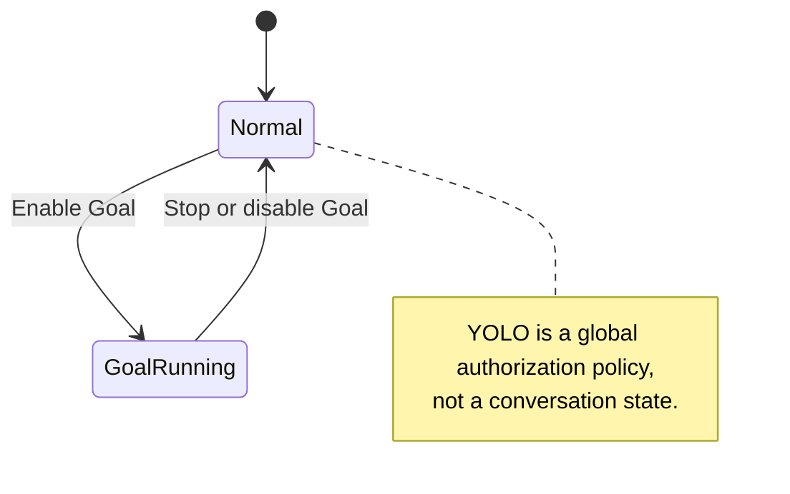
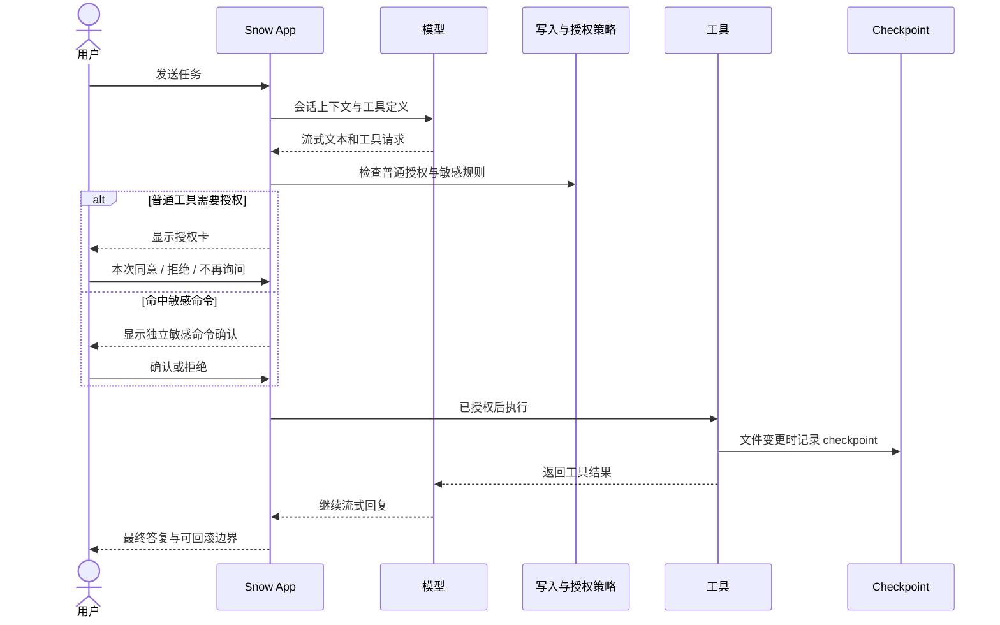

# 10-使用聊天与 AI 助手

Snow App 以对话作为 AI 协作入口。AI 除了流式回复文本，还能在授权边界内读取和修改文件、执行命令、搜索网络、操作浏览器、生成图片并调用子代理；每一步都会以工具卡片展示。

## 1. 界面与开始对话

### HTML 动态预览

文件工具成功创建、编辑或复制 `.html` / `.htm` 后，会话区会在工具组外直接显示动态预览卡片，无需 AI 再输出代码块。最终回复只有文件链接时，同轮同文件只保留一张卡片并展示在引用回复下；重新打开历史会话也会从成功工具记录恢复。页面内容从真实本地或 SSH 文件读取，不使用工具参数或编辑片段代替文件。

没有成功写入记录的 HTML 链接只显示「加载预览」入口，点击链接或该按钮才读取；单纯提到路径不会自动读取。刷新会读取当前文件，文件已删除、无法读取、二进制或超过 2 MiB 时不执行。后续写入尚未成功时预览暂停。卡片可切换代码、刷新，或显式在应用内浏览器打开本地文件；自动预览不会打开右侧浏览器。

AI 回复正文及 sections 中，标注为 `html`、`htm` 或 `text/html` 的围栏代码块默认动态预览：语言标签不区分大小写，允许标签后的元信息。仅当消息不处于流式生成、错误、重试或中断状态，源围栏真实闭合，且 DOM 已提交的渲染结果与当前内容快照一致时，才自动在独立沙箱中运行自包含的 HTML、CSS 和 JavaScript。点击「代码」会移除 iframe 并停止运行，同一 DOM 块后续同步不会抢回预览；再次点击「动态预览」从头执行。思考内容、Markdown 文件阅读器和编辑器仍须显式点击预览。流式期间或围栏未闭合时不可执行，普通 Markdown HTML、JavaScript 和 React 代码块不会自动运行。

HTML 围栏和文件卡片的代码视图提供 IDE 式多色语法高亮，区分 HTML 标签及内嵌 CSS、JavaScript；文件卡片仅在切到代码视图时计算高亮。语言识别与配色和普通聊天代码块、工具源码、文件阅读器统一复用，适配浅色与深色主题，切换主题不会重新运行预览。复制和沙箱运行始终使用原文；超出 131,072 字符的同步高亮预算时，完整显示安全转义的纯文本，不截断源码。

布局只在共享 `src/renderer/styles.css` 中定义；Vite 在末阶段将 `.html-artifact-frame` 与 `.html-artifact-carrier` 两条布局规则内嵌到独立承载页，不依赖不透明 `file:` 沙箱读取外部 CSS，避免内层 iframe 回退到左上角的 `300×150` 默认尺寸。此修复不放宽沙箱隔离或 CSP。

预览禁止网络请求、外部脚本/样式/字体、表单、对象、嵌套框架与宿主 API；允许内联脚本/样式及 data/blob 图片。CDN 依赖与 JSX 编译不可用。固定视口内可滚动；它不提供 CPU/内存限额，也不承诺禁止文档自身导航。只预览你信任的代码。

| 区域           | 内容                                                                     |
| -------------- | ------------------------------------------------------------------------ |
| 侧边栏         | 本地/SSH 项目、会话列表、备忘录、定时任务、设置入口                      |
| 主区域         | AI 对话、终端、Git、浏览器、代码库、图像库等视图                         |
| 右侧面板       | 文件阅读器、Markdown/Office/图片预览、Diff 与 Git 面板，可多标签         |
| 顶部栏与输入区 | 切换视图/API 档案，选择模型和思考强度，输入 `/` 命令、`@` 文件或粘贴图片 |

1. 在侧边栏选择项目并创建或打开会话；
2. 输入任务并发送，`Shift+Enter` 换行；
3. AI 流式输出，并在需要时请求工具授权；
4. 工具完成后，结果回传给 AI，继续生成回复。

```text
请查找当前项目中的 Python 文件，读取关键入口，并总结各文件用途。
```

模型与 API 档案配置见 [3-配置 API 密钥与模型](3-配置API密钥与模型.md)。

**会话模型路由**：普通会话使用该会话选定的模型。Snow App 不会根据提示词复杂度在基础/高级模型之间自动切换；`advancedModel` 只是会话所属 Profile 的默认高级模型，且 `advancedModel` 与 `basicModel` 不会互相回退。

**标题路由**：首次生成会话标题时使用 `basicModel`，供应商、凭证和 Profile 跟随该会话绑定的 Profile；若绑定档案已删除，则按普通会话规则回退当前 active Profile。

### 1.1 管理本地项目与工作区

左侧“项目”区域既能创建新的磁盘目录，也能登记已有目录。两种操作的边界不同：

1. **创建项目**：点击“+”并选择“创建项目”，填写项目名，再选择保存它的父目录。主进程会在磁盘上创建真实项目目录，把它登记为本地工作区，并将它设为活动工作区；
2. **添加已有本地目录**：选择“添加本地目录”，可通过目录选择器选取文件夹，也可向对话框**恰好拖入一个文件夹**。Snow 只登记已有路径，不会复制其内容，并把新条目设为活动工作区；
3. **激活与排序**：点击工作区，或从三点/右键菜单选择“设为活动”，即可切换当前上下文。拖拽工作区条目可调整顺序，新的 `sortOrder` 会持久化；
4. **重命名与移除**：菜单中的“重命名”只修改 Snow 内显示名称，`directoryId` 与磁盘路径保持不变；“删除”经确认后从工作区列表移除登记，它不同于在项目资源管理器中删除文件或目录；
5. **查看详情**：菜单中的“详情”进入该工作区的项目资源管理器，即使它不是当前活动工作区也可查看；资源管理器的文件操作见 [12-Git 面板与代码浏览](12-Git面板与代码浏览.md)。

SSH 工作区不走本地目录选择/拖入流程，而是选择“添加 SSH 目录”进入独立连接向导；凭据、远程路径与重连规则见 [11-终端与 SSH 远程管理](11-终端与SSH远程管理.md)。

## 2. 会话与输入

### 2.1 会话操作

会话行的「⋯」或右键菜单支持：置顶/取消置顶、重命名（也可双击标题）、设置图标、导出 Markdown/HTML/JSON/CSV、进入多选模式和删除。草稿文字与图片按会话保存，切换会话后会恢复，发送成功后清除。

切换项目时，聊天区会自动定位到该项目**正在运行**的会话（流式生成中或需要关注；有多个时取运行列表中的第一个），没有运行中的会话则自动新建一个。通过跨项目通知、系统通知、远端控制等方式明确打开某个会话时不会被覆盖。

单条删除和批量删除都需要确认。删除会话还会中止相关流、级联删除其子代理会话，并清理对应输入草稿。若会话引用图库图片，确认框会显示「同时删除图片」选项：

- 默认**不勾选**，因此删除会话时保留图库中的图片；
- 只有主动勾选后，才会同时删除引用图片的物理文件和 SQLite 图库索引；
- 直接在图像库删除单图是另一项操作，会删除文件与索引并改写引用该图的会话消息。

#### 拖拽会话注入开头上下文

从会话列表**拖拽历史会话到聊天输入框**，会把它附加为「开头上下文」，随**下一条消息**一起注入：

- 输入框上方出现**附件栏**，显示附带的会话与估算字符数，可单个移除或折叠为摘要行；
- 多条附带会话按拖入顺序拼接，先注入再拼接当前消息；
- 注入预算可在设置中调整：单条预算默认 `40000` 字符、总预算默认 `60000` 字符（范围 `1000–200000`），超出部分会被截断；
- 拖拽到已有草稿的输入框同样生效；发送成功后附件随消息消费，不会残留到后续消息。

### 2.2 跨项目通知聚合

侧边栏「对话」区域默认只展示**当前项目**的会话；当**其他项目**的会话产生动态时，会在会话列表下方聚合为**跨项目通知**区块，避免切换项目后丢失后台会话的状态：

- **聚合内容**：其他项目中处于**流式生成中**、**需要关注**（如等待审批/提问）或**已完成**的会话，按所属项目分组展示，组内按最近更新时间倒序；
- **状态徽标**：流式会话显示进行中动画；需要关注的会话带 **attention-required** 强调徽标（会话列表中的条目同样显示该指示）；
- **快速跳转**：点击某条通知会切换到该项目并打开对应会话，随后该会话状态改由当前项目列表正常展示；
- **项目名回退**：无法解析项目显示名时使用目录路径末级名称兜底。

### 2.3 文件与图片

- 输入 `@` 可搜索工作区文件；目录可逐级进入，面包屑可返回任意层级，`←` 返回上级；
- 输入 `@@<关键词>` 可**按文件内容搜索**：只列出正文命中关键词的文件，结果中标注命中的行号与行内容；选中后以带行号的文件引用（`文件名:L5,L20`）插入，发送时这些行的内容会直接带给 AI；
- 输入 `@?<关键词>` 可发起**自然语言文件搜索**（见 [12-Git 面板与代码浏览](12-Git面板与代码浏览.md)）；
- 输入 `#` 可列出并搜索**已启用的 Skills**，也可使用 `@!<关键词>`；用方向键和 Enter 或点击选择一个或多个。发送、排队或插话的消息开始处理时，宿主会在模型处理任务前加载所选 Skill；调用仍遵循工具开关、授权和 Hooks，拒绝或加载失败会中止当前任务；
- 可勾选或拖入整个目录，让 AI 按需读取其中内容；
- 图片可粘贴或拖入，支持单张和多张。主模型不支持视觉时，外挂视觉模型会先生成文字描述，同时保留安全的 `upload/...` 原图引用，供后续图生图使用；
- 图像生成和参考图规则见 [9-图像生成](9-图像生成.md)。

### 2.4 繁忙时的发送行为

在「通用设置 → 繁忙时的发送行为」选择「插话发送」或「排队发送」。首次使用、没有有效偏好时默认「插话发送」；已明确保存的「排队发送」选择仍保留。偏好持久化，保存成功后即时同步输入框；保存失败会显示提示并保留原值。

这里的「运行结束」指当前 Agent 执行结束，不是关闭会话窗口，也不保证业务目标已成功达成。需要随后处理另一件事时，例如「完成后再整理设置页面」，选择排队；需要调整正在做的事时，例如「保留当前公开接口不变」，选择插话。插话和中断都不会自动回滚已经完成的操作。

- **排队发送**：消息留在当前会话的待发送队列，等这一整次 Agent 运行（含工具与停止 Hook 收尾）正常结束后，再逐条启动后续任务；不会在工具之间插入，也不会合并多条任务。
- **插话发送**：消息绑定当前运行，在模型响应或工具批次完整结算后的安全边界追加要求，继续当前任务。不会中断已经运行的工具，也不会启动另一个并行循环。等待期间显示「等待插话处理」；进入模型请求后成为普通用户消息，这不代表指令已经执行成功。
- **中断并发送**：待发送卡片上的箭头保留为独立操作，会停止当前运行并重新发送所选消息，不等同于插话。

繁忙时，发送按钮和默认发送键使用所选行为；按钮旁菜单可临时选择排队或插话，不修改全局默认：

| 发送键偏好          | 默认行为       | 本次使用另一行为     |
| ------------------- | -------------- | -------------------- |
| Enter 发送          | Enter          | Ctrl/Cmd+Enter       |
| Ctrl/Cmd+Enter 发送 | Ctrl/Cmd+Enter | Ctrl/Cmd+Shift+Enter |

`Shift+Enter` 仍然换行，中文输入法组合输入不触发发送。空闲时正常发送；插件、定时任务等程序化发送不继承手动插话偏好。

队列按会话隔离。主动停止、异常或不可续跑授权拒绝后保留未消费消息，不自动启动下一条；未消费插话转为排队。不兼容当前运行配置的插话（如切换模型或渠道）也转为排队；子代理与 Workflow 节点不支持的配置切换会保留消息并显示说明，不转交父会话。

**待发送队列是本次应用运行的内存状态，不承诺关闭或重启后恢复**；发送行为偏好则会持久化。尚未消费的排队消息或插话可撤回到输入框编辑；已经消费的要求需要另发消息纠正，不能通过撤回来撤销执行。插话不能自动撤销已经执行的操作。

### 2.5 手动优化草稿（未发布源码能力）

以下行为需本次配套宿主构建与支持该入口的可信 ESM 插件，尚未确认正式发行版本；安装插件不会升级 Snow App。

- 在输入工具栏模型选择器左侧点击插件魔杖，手动优化当前纯文本草稿。Agent 运行或停止中，只要输入仍可编辑就可优化；压缩中、无纯文本或 API 配置不可用时不能执行。
- 优化只回填草稿，不自动发送，也不修改已排队条目。发送仍由用户决定，遵循 §2.4 的排队 / 插话规则；优化取消独立于普通聊天，不停止 Agent。
- 草稿回填与还原使用绑定输入实例、项目、真实 / pending 会话、修订与原稿的单次令牌。编辑、实际发送清空、切换上下文或进入压缩会拒绝旧结果；实时回复和运行 / 停止状态本身不会使令牌失效。
- 优化成功后，「还原」入口位于魔杖右侧的「更多操作」下拉菜单，不再占用输入栏；输入栏不显示常驻的优化差异与预览框。
- 提示词优化插件的配置齿轮默认隐藏，魔杖仍保留。通过右侧插件面板的显示开关独立持久保存齿轮偏好；隐藏齿轮不禁用插件、不保存尚未保存的策略。其他插件可通过通用 `chatInputSettings` 声明自己的默认值；未声明时保持齿轮可见。打开齿轮只打开配置，不执行或取消优化。

待发送队列区域高度受 `min(144px, 20vh)` 限制，条目较多时在区域内滚动；这不改变排队 / 插话语义或队列的内存生命周期。

契约详见[插件开发与安装 §6.1](24-插件开发与安装.md)。源码入口：`src/renderer/components/mainContent/chatInput/ChatInputPluginAction.tsx`、`src/renderer/plugins/pluginDraft.ts` 与 `src/renderer/styles.css`。

### 2.6 WorkFlow 手动编排

开启 WorkFlow 模式后，输入工具栏分隔符右侧的模式指示区会出现编排入口（WorkFlow 图标，悬停提示「手动编排 WorkFlow」；它与原来的 WorkFlow 模式徽标合并为一个可点击入口），点击打开「WorkFlow 编排器」弹窗，由你亲手绘制一张工作流图。该入口仅在 WorkFlow 模式开启时显示，关闭模式即从工具栏消失；子代理会话中该按钮禁用。

1. 画布打开时已预置一个空节点（提示词待填），可直接编辑；继续放置节点用工具栏「添加节点」或右键画布「添加节点」，连续添加会错开位置避免重叠；
2. 点击或右键节点选择「编辑节点」，填写节点名称与提示词，并可按节点选择 API 配置（默认「继承任务运行配置」）与高级模型；
3. 从节点右侧连接点拖到另一节点左侧连接点即可连线；自环、重复边与成环会被直接拒绝（连线落不下来）。右键连线可「删除连线」，右键节点可「删除节点」，`Backspace` / `Delete` 删除选中项；
4. 视野不够时点「放大画布」。「流程名称」可留空，「备注」随流程一起发送；
5. 点「发送」前会先校验：至少一个节点、至少一个节点提示词非空（否则提示「请至少添加一个节点」/「请至少填写一个节点的提示词」），再做一次拓扑校验（失败提示「流程无效：…」）。

发送后发生的事：

- 弹窗关闭，**不经 AI 转交**：应用直接写入一条用户消息和一条带 `workflow-workflow-generate` 调用的助手消息，本回合**强制启用 WorkFlow 模式**（只作用于本次 run，会话自身的 WorkFlow 模式开关不会被改写）；
- 用户消息显示为折叠的 WorkFlow 标签（「WorkFlow: 流程名」+ 节点 / 连线数，悬停查看节点清单）加你填写的备注，不显示 JSON；
- 会话中立即出现工作流卡片（「生成工作流」），无需工具授权确认。卡片上的画布仍可继续编辑，确认无误后点「确认执行」才开始运行；
- 执行期间的节点状态、失败续跑（「继续执行」）等行为与其它 WorkFlow 卡片一致；执行结果照常回传 AI，由 AI 总结或按失败结果询问是否续跑；
- 会话正在运行时点「发送」不会打断当前回合：消息进入待发送队列（见 §2.4），当前回合结束后自动以同一张图发送。

与「AI 自动设计流程」的区别：

| 入口                         | 谁决定流程                       | 适用场景                                     |
| ---------------------------- | -------------------------------- | -------------------------------------------- |
| 加号菜单的 WorkFlow 模式     | 模型按需求自行拆解节点与依赖     | 需求还在探索，愿意让 AI 先给出方案           |
| 输入工具栏的 WorkFlow 编排器 | 你指定每一步的提示词、模型与依赖 | 步骤与分工已明确，需要固定流程或复用同一张图 |

两者最终都落到同一张工作流卡片与同一套执行链路：都要在卡片上确认后才执行，节点会话、状态与失败续跑语义一致。编排器提交的图就是你绘制的图，不会被模型改写。关闭弹窗不会保留已绘制的图：再次打开是一张新的空白画布。

## 3. 完整斜杠命令

输入 `/` 打开命令面板。当前版本共 12 个命令：

| 命令                  | 行为与可用条件                                                                                                                               |
| --------------------- | -------------------------------------------------------------------------------------------------------------------------------------------- |
| `/clear`              | 创建一个新会话；不是 `/new`，也不会在原会话内抹除历史                                                                                        |
| `/help`               | 把「问 Snow 怎么用」的提示词放进输入框（不自动发送），补充问题后发送，由 AI 查阅内置文档回答；不依赖项目，随时可用                           |
| `/file-changes`       | 查看当前会话的文件变更与 Diff；尚无已持久化会话时禁用                                                                                        |
| `/memory`             | 查看当前会话（含子代理与 WorkFlow 节点）保存或更新的项目记忆，可展开全文、跳转到项目记忆库定位，或删除本次对话的记忆；尚无已持久化会话时禁用 |
| `/mcp`                | 管理当前项目的 MCP；需要已选择项目                                                                                                           |
| `/role`               | 编辑当前项目的 `ROLE.md`；需要已选择项目                                                                                                     |
| `/sensitive-commands` | 配置当前项目的敏感命令规则；需要已选择项目                                                                                                   |
| `/permissions`        | 查看/删除当前项目的永久授权工具；需要已选择项目，YOLO 模式下禁用                                                                             |
| `/skills`             | 管理当前项目的 Skills；需要已选择项目                                                                                                        |
| `/codebase`           | 管理当前项目的代码库索引；需要已选择项目                                                                                                     |
| `/review`             | 让 AI 审查当前项目的 Git 变更；仅新会话且存在项目目录时可用                                                                                  |
| `/compact`            | 压缩当前会话；无消息或正在压缩时禁用                                                                                                         |

AI 运行期间，`/compact`、`/role`、`/sensitive-commands`、`/skills`、`/codebase`、`/mcp`、`/review` 会禁用。`/file-changes`、`/memory` 与 `/clear` 不在这组运行中禁用命令内，但仍受各自条件约束。

需要快速上手时，可以点击侧栏底部的「使用指南」、在空状态欢迎语下点「问一下」，或输入 `/help`。它们只把「问 Snow 怎么用」的提示词放进输入框，由你确认后再发送；空状态提示可点「不再提示」永久关闭。这些入口依赖内置的 `snow-app-docs` 技能：若该技能已在 Skills 设置中关闭，会先弹窗提示开启，不会放入提示词。

## 4. Goal 与 YOLO

### 4.1 Goal Mode

Goal Mode 是持续的目标驱动自主循环。它会在配置的 token 预算和停止条件内持续推进任务；预算可在加号菜单中调整（含**无限**选项）。Goal 的开关与预算都按会话保存。

运行时有两条硬性约束：

- AI 必须先通过 `todo-todo-manage` 为本次目标建立待办列表；
- 当 AI 停止而待办列表尚未全部完成时，应用会自动追加一条「Goal 模式自动续跑」用户消息（内含当前待办进度与 token 预算），并据此重新激活循环，直到全部待办完成或 token 预算耗尽。

这条续跑消息会作为普通用户消息保存在会话中，因此在会话区和用户消息导航里都能看到每次自动续跑，也可以被回滚。用户主动停止（取消）后不会再被自动激活。循环次数由 token 预算约束：预算设为**无限**时，循环只会在待办全部完成或用户停止时结束。

### 4.2 YOLO Mode

YOLO 是**全局持久化授权策略**，不是会话模式：

- 自动批准普通工具调用，也会处理当前待决的非敏感授权；
- 已设置为永久批准的工具同样可直接通过；
- **不能绕过敏感命令规则**。`bash-terminal-execute` 命中当前项目合并后的敏感规则时，即使开启 YOLO 仍必须单独确认；
- 交互式命令不弹独立的敏感命令确认，因为用户会在交互终端中逐次输入；
- YOLO 下普通 `toolConfirmation` 确认阶段不运行，但执行前策略门仍然有效。



## 5. 工具授权与敏感命令

未开启 YOLO 且工具未被永久批准时，Snow App 显示授权卡。你可以：

- **同意本次**：只执行本次调用；
- **拒绝**：该调用不执行，拒绝结果会返回给 AI；
- **同意且不再询问**：有项目时持久化为项目级工具批准；无项目时只加入当前应用进程内的批准集合。

同一批工具必须全部完成授权决定后才会开始执行。`user-interaction-askUserQuestion` 会直接进入交互问答，不走普通工具批准卡。敏感 Bash 命令始终使用独立确认，普通工具的永久批准和 YOLO 都不能代替它。

同一轮内相邻的多个提问会合并为一个 Tab 容器（Q1 / Q2… + 状态标记，一次只显示一个问题）：提交后自动切到下一个未回答的问题，全部完成后 Tab 保留以便回看答案；用 `←` / `→`、Tab 头或左右切换按钮换题，等待作答的问题显示脉冲点，已回答 / 已取消 / 已中断 / 失败显示对应图标。单个提问仍是原卡片形态，不出现 Tab 头。



## 6. 工具卡片与消息操作

常见工具卡片包括命令输出、持久终端、文件读取与 Diff、搜索结果、浏览器截图与网络信息、TODO、图像生成、子代理及代码诊断。文件修改后可用 `/file-changes` 集中查看本会话的改动。

AI 消息支持复制、复制 Markdown、复制纯文本、切换原始 Markdown、停止生成和回滚。渲染支持表格、代码块、KaTeX（`$...$` / `$$...$$`）与 Mermaid。

### 6.1 按任务保留插件卡片（未发布源码能力）

支持 `contributions.messageFooters` 中 `taskHistory: true` 的插件，可在可靠持久化的任务结束回复下展示该次任务卡片；下一任务开始后旧卡片仍保留，文件统计与内联 Diff 由插件实现，不是宿主固定 UI。

一次外层发送创建稳定任务 ID；工具多轮、该任务子代理与被接纳的插话归属同一任务，排队后续消息真正开始时才创建下一任务。宿主把记录引用关联到持久结束回复，重开会话或重启后从原始工具记录重建只读快照，不用当前磁盘或会话累计改动冒充旧任务 Diff。

旧历史没有可靠归属时只可显示兼容提示，不猜测、不累计回退；无文件任务不能借用前次文件。缺失记录、保存失败或结束保存前退出不承诺恢复；删除 / 回滚相关消息后不承诺保留卡片，虚拟化重新挂载也不承诺保留展开状态。需要配套宿主与原生模块构建，尚未确认正式发行版本；真实 UI 与重启恢复仍待验收。

契约详见[插件开发与安装的任务结束插槽](24-插件开发与安装.md)。源码入口：`src/renderer/components/mainContent/chatMessages/hooks/taskHistory.ts`、`src/renderer/components/mainContent/chatMessages/components/PluginMessageFooters.tsx` 与 `native/src/storage/services/chat_conversations/task_history.rs`。

## 7. Checkpoint 与消息回滚

在目标 AI 消息或压缩边界选择回滚前，应先查看 Diff。可选择：

- **仅回滚会话**：删除目标边界及其后的消息，恢复消息时间线；
- **回滚会话和文件**：除消息外，还恢复 checkpoint 记录的文件，并清理关联 TODO。

恢复能力有明确边界：checkpoint 缺失、已清理，或外部变更未被 checkpoint 覆盖时，不能保证恢复。回滚不是通用备份替代方案。

回滚一条**编排器提交**的消息时，编排图无法写进输入框：应用会重新打开「WorkFlow 编排器」，按消息里的图快照还原画布、流程名与备注，改完再发送即可。旧消息若没有图快照，则只把备注回填到输入框。

## 8. 上下文压缩

`/compact` 会把后续发送给模型的上下文切换为交接摘要，从而降低上下文占用；正常继续聊天时不会自动展开压缩前的旧上下文。

压缩**不是绝对不可逆**：压缩消息是带 `checkpoint_id` 的 `context_compaction` 边界，可把该边界作为消息回滚目标。选择“仅回滚会话”可恢复消息边界；选择“回滚会话和文件”还会尝试恢复 checkpoint 文件并清理关联 TODO。恢复仍受 checkpoint 是否存在及覆盖范围限制，因此压缩后应先确认摘要完整，回滚前应先查看 Diff。

## 9. 定时任务与备忘录

- 定时任务可由侧边栏或 `config-set scope=scheduledTasks key="new"` 创建，支持单次执行、固定间隔或每日固定时刻。任务保存在本地数据库中，重启应用后仍会保留并继续执行；应用未运行时错过的执行会被跳过；
- 定时任务可用 `model` 固定主请求高级模型，并用 `basicModel` 固定首次会话标题模型。若指定 `apiProfile` 但省略 `model`，高级默认值只取同一 Profile 的 `advancedModel`，不会借用当前会话或其他 Profile 的模型；`basicModel` 省略时使用任务会话绑定 Profile 的默认值，且不会影响主请求；`thinkingStrength` 省略或 trim 后为空时不保存快照，在任务触发时继承所用 Profile 的最新配置；
- 备忘录可在侧边栏创建、编辑和删除，AI 也可通过 `config` 工具的 `memos` 作用域按当前项目创建、读取、更新和删除备忘录（删除需用户确认）；面板顶部支持关键词搜索（不区分大小写、命中处高亮，`/` 或 `Ctrl/Cmd+K` 聚焦搜索框）、全部 / 未完成 / 已完成状态筛选，以及按更新时间（默认）或创建时间升降序排序，三者可叠加使用，切换条目状态不会让条目从当前视图消失。
- AI 可通过 `config` 工具读取和维护全局站点拦截规则 `proxy_browser_settings.blockedPatterns`：`config-get scope=appSettings key=blockedPatterns` 读取规则，`config-set scope=appSettings key=blockedPatterns` 的 `value` 传数组（完整替换）或 `{add|remove|replace: string[]}` 添加、删除或完整替换规则。规则不是项目级配置，更新时会校验 JavaScript 正则，并影响 `websearch` 结果过滤和 `websearch-fetch` 抓取拒绝。

## 10. 后台通知、托盘与窗口

- 当 Snow 没有处于前台聚焦状态时，**AI 流程完成**、**敏感命令等待确认**或 **`askUserQuestion` 等待回答**会触发系统通知；应用已聚焦时不会重复弹出通知。点击带会话目标的通知会恢复并聚焦窗口，校验目标仍存在后切换到对应工作区与会话。若原窗口已被销毁或渲染帧刷新，点击通知会回退到主窗口或重建窗口，暂存激活目标并在加载完成后重新派发，避免激活消息静默丢失。平台不支持系统通知时，Snow 会改用任务栏闪烁或 macOS Dock 跳动提醒；
- 所有平台的窗口关闭入口都会先显示确认框。可以取消、选择“最小化”隐藏到系统托盘而不退出，或确认彻底退出；隐藏期间会话、终端和进程内定时任务继续运行。macOS 隐藏时还会暂时移除 Dock 图标；
- 单击托盘图标或选择“打开 Snow App”会恢复、显示并聚焦主窗口；托盘菜单的“退出”会直接结束应用。托盘悬停信息会周期性汇总进行中会话、活动终端、项目数、待办备忘录和今日 Token 用量；有进行中会话时图标显示活动标记；
- 顶栏可折叠侧边栏、折叠或全屏显示右侧面板；拖动两侧分隔条可调整宽度。主窗口会保存尺寸、位置和最大化状态，下次启动时恢复；保存位置不再位于任何显示器可见区域时会回退到安全位置。

## 11. 常见问题

| 症状                                    | 处理                                                                                                                                                                                                                                                                                                                                                                  |
| --------------------------------------- | --------------------------------------------------------------------------------------------------------------------------------------------------------------------------------------------------------------------------------------------------------------------------------------------------------------------------------------------------------------------- |
| AI 没有可用工具                         | 检查 API 档案、模型和相应工具配置；图像生成需独立配置渠道                                                                                                                                                                                                                                                                                                             |
| 工具一直未执行                          | 检查同批工具是否仍有待决授权                                                                                                                                                                                                                                                                                                                                          |
| YOLO 下仍要求确认命令                   | 命中了敏感命令规则，这是预期安全行为                                                                                                                                                                                                                                                                                                                                  |
| `/review` 不可用                        | 仅新会话且存在项目目录时可用                                                                                                                                                                                                                                                                                                                                          |
| 压缩后看不到旧上下文                    | 后续模型上下文已切到摘要；需要时从压缩边界执行消息回滚                                                                                                                                                                                                                                                                                                                |
| 删除会话后图片仍在                      | 默认保留图库图片；只有删除确认时勾选「同时删除图片」才级联删除                                                                                                                                                                                                                                                                                                        |
| 关闭窗口后任务停止                      | 关闭确认框应选择“最小化”隐藏到托盘；选择“退出”会结束进程并清除仅存于内存的定时任务                                                                                                                                                                                                                                                                                    |
| 回答流中途发生响应体读取错误            | Rust 后端会在 API 档案的 `maxRetries` 与既有可取消退避范围内无感重试；重试期间消息仍显示普通流光标，失败尝试的正文、思考、用量、响应元数据与工具碎片会被丢弃。若重试耗尽，则保留不完整结果并显示既有中断提示；明确的供应商终止状态不会进入传输重试。Unexpected EOF 或空闲超时仍沿用既有部分正文阈值：已输出大量文本（约 1000 字符以上且无工具状态）时可保留不完整结果 |
| AI 返回空响应（无正文、思考与工具调用） | 供应商虽正常终止但没有任何可用载荷时同样按可恢复故障处理：Rust 后端会在同一 `maxRetries` 预算与退避内重试；失败尝试未输出任何正文，重试不会污染消息内容。重试耗尽后落库为 `empty_response` 终态，消息上只显示一张「重试已耗尽 (N)」卡片（含上游错误详情），不再叠加第二条「响应未完整结束」提示                                                                       |
| 点「停止生成」后仍显示中断或重试提示    | 用户主动停止不应产生任何告警：取消由 `status=cancelled` 承载并静默收尾（保留已输出内容）。升级后新数据不再出现该提示，历史会话中「取消 + 空响应」的组合会被一次性迁移清理                                                                                                                                                                                             |

## 12. 参考

- [内置工具参考](../3-参考手册/2-内置工具参考.md)
- [配置 API 密钥与模型](3-配置API密钥与模型.md)
- [图像生成](9-图像生成.md)
